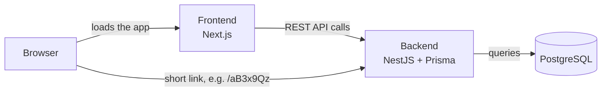
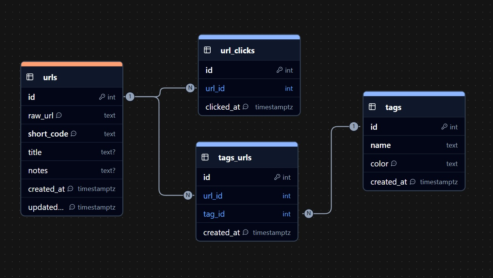
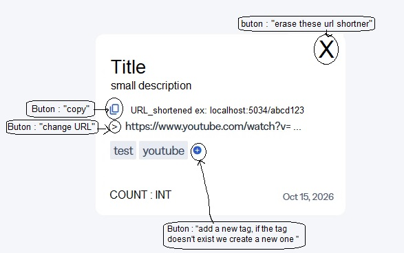

# Mini Roads

A URL shortener I built to practice NestJS, Prisma and Next.js. You put in a long link, it
gives you back a short one, and you can track how many times it got clicked.

The main focus here was getting the short-code creation and redirection right, plus a clean,
well-tested backend. A few things (auth, folders, analytics...) got left out on purpose — see
[What I'd add next](#what-id-add-next).

## Index

- [Architecture](#architecture)
- [Setup](#setup)
- [Running it](#running-it)
- [Connecting with DBeaver](#connecting-with-dbeaver)
- [Database schema](#database-schema)
- [API examples](#api-examples)
- [Tests](#tests)
- [References](#references)
- [What I'd add next](#what-id-add-next)

## Architecture

Three pieces, each in its own Docker container:



The frontend only talks to the backend over REST (`/v1/...`). The one exception is the short
link itself: `localhost:3003/aB3x9Qz` goes straight to the backend, not through the frontend, so
redirecting is as fast as possible. Prisma is the only thing that talks to Postgres directly.

## Setup

Copy [`.env.example`](.env.example) to `.env` and fill in your own password:

```
cp .env.example .env
```

That's the only setup step. Docker takes care of the rest (Postgres, migrations, installing
packages).

## Running it

Everything goes through the `Makefile`:

| Command | What it does |
|---|---|
| `make up` | builds and starts everything (db, api, frontend) |
| `make down` | stops everything |
| `make re` | down + up, for when something gets stuck |
| `make test` | runs the backend's e2e tests (needs `make up` running first) |
| `make add_mock_data_into_db` | wipes the db and fills it with sample urls/tags/clicks, so I don't have to create data by hand every time I test something |

Once it's up:
- Frontend: http://localhost:3000
- API: http://localhost:3003

## Connecting with DBeaver

I used [DBeaver](https://dbeaver.io/) to look at the database directly while testing — handy
for checking what the API actually saved, without going through Postgres' own CLI.

Once `make up` is running, create a new PostgreSQL connection in DBeaver with these details
(all values come from [`.env.example`](.env.example)):

| Field | Value |
|---|---|
| Host | `localhost` |
| Port | `5434` |
| Database | `mr_urlshortener` |
| Username | `mr` |
| Password | `yourPassword123` |

Port `5434`, not the usual `5432` — see the port mapping in `docker-compose.yml`, `5432`/`5433`
were already taken by other projects on my machine.

## Database schema

4 tables: `urls`, `tags`, `tags_urls` (the join table linking them) and `url_clicks` (one row
per redirect, for the click count).



## API examples

I kept a `.http` file per resource under `backend/manual_tests/`, with ready-to-run requests
for every case I tested by hand — including the error ones, like going over a limit or using
the wrong protocol. Open them with the REST Client extension (or anything similar) and just
click "Send Request".

- [`urls.http`](backend/manual_tests/urls.http) — create, list, update, delete a url. Also the
  validation errors: https-only, title/notes too long, empty patch.
- [`tags.http`](backend/manual_tests/tags.http) — create, list, update, delete a tag. Tag names
  are case-insensitive, and deleting a tag removes it from every url that had it.
- [`tags_urls.http`](backend/manual_tests/tags_urls.http) — tag a url, list urls by tag, remove
  a tag from a url, and the max-7-tags-per-url error.
- [`clicks.http`](backend/manual_tests/clicks.http) — check how many times a url was clicked.
- [`redirect.http`](backend/manual_tests/redirect.http) — the full flow: create a url, follow
  its short code, see the click count go up.

## Tests

```
make test
```

Runs the backend's e2e suite against a real database (not mocks) — one spec file per resource,
covering the happy path and the validation errors.

## References

I looked at [Bitly](https://bitly.com/) and [Dub](https://dub.co/) while figuring out the card
layout and the analytics side — screenshots with my own notes on them are in
[`references/`](references/).

This one was the most useful: a quick Paint sketch I made to plan out what one card needed to
show, before building `url-card.tsx` — which button does what, where the tags go, where the
click count goes.



## What I'd add next

Things I thought about but left out, either on purpose or because of time:

- **Auth / multiple users** — I'm treating this as YAGNI for now. The focus here was getting
  the short-code creation and redirection right, not building a user system. Same reasoning for
  JWT, or a simple API-level secret in the headers.
- **Folders** — I had a whole feature built for organizing urls into folders, but cut it to keep
  the project focused.
- **Analytics and charts** — I'd love to spend more time on this: clicks over time, broken down
  by tag and/or folder.
- **Pagination on `GET /urls/all`** — I already built this once, in an early frontend test with
  mock data, but it was too much extra work to bring into this version.
- **A QR code generator** — could be a fun small addition.
- **More design around the "roads and connections" theme** — the visual identity could go
  further.
- **Better UX/UI in general** — the UI is pretty basic right now. Tags especially could use a
  better experience.
- **More sidebar features** — analytics, settings, filtering by tag/folder.
- **UUIDs at the database level**, to send to the front end instead of id.
- Keep going deeper with NestJS and Next.js — there's a lot that i have to learn in these technologies.
